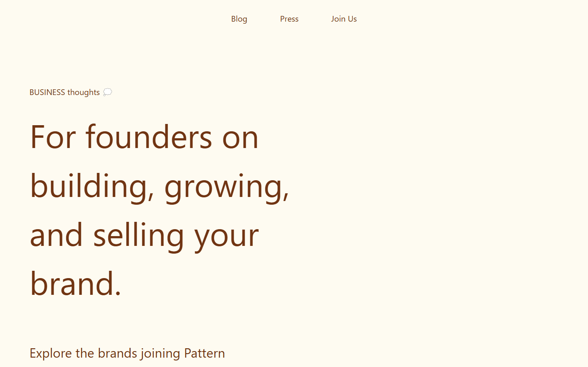

# Pattern — business blog page



**🇷🇺** Учебная вёрстка страницы бизнес-блога по макету из Figma.

**🇬🇧** Business blog page built from a Figma design (learning project).

**Стек / Stack:** HTML, Tailwind CSS

## Запуск / Run

```bash
npm install
npx tailwindcss -i ./src/input.css -o ./src/output.css --watch
```

Откройте / open `src/index.html` в браузере.
